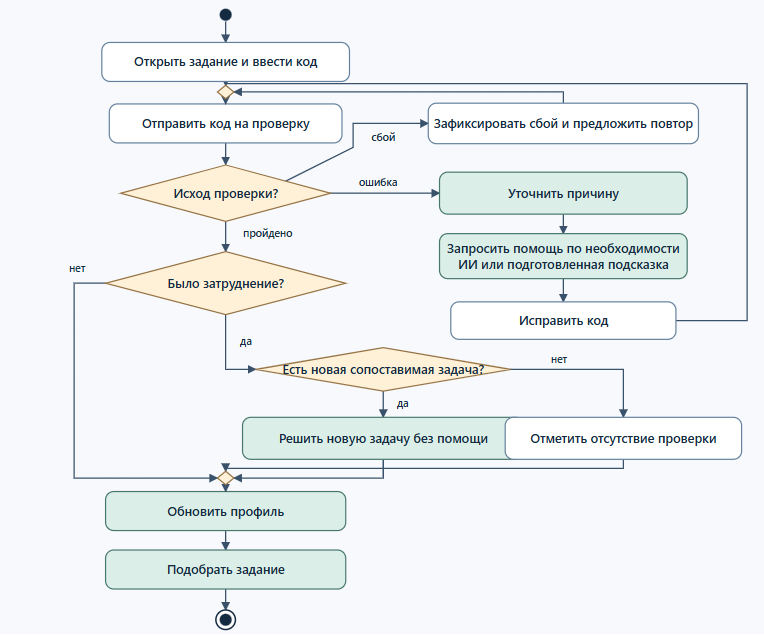
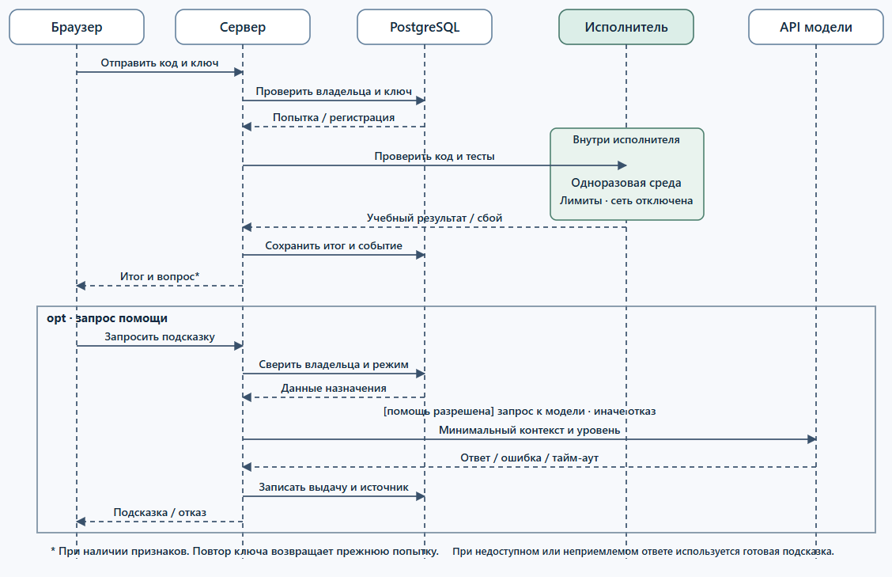
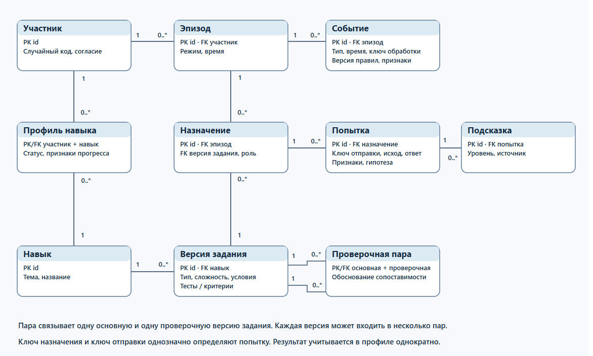
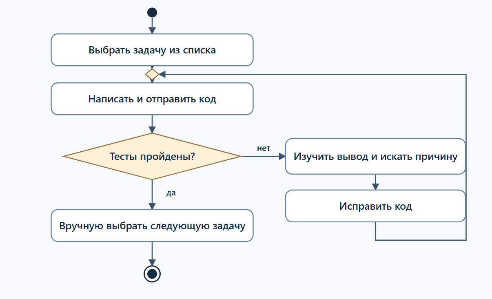
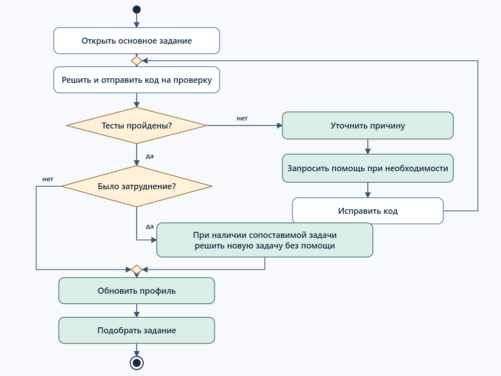

# ЛР 3 — проектирование

**Тема ВКР:** Разработка адаптивного веб-сервиса для обучения программированию на языке JavaScript с применением искусственного интеллекта для анализа ошибок и формирования персонализированной обратной связи

**Автор или участники команды:** Азатжонова Мехринисо Азизжон кизи, группа К3422

**Вклад каждого участника при командной работе:** Индивидуальная работа

## 1. Предметная область и требования

### Описание предметной области

Проектируется веб-сервис для самостоятельной практики по циклам, массивам и функциям JavaScript. Для первой версии готовятся основные задания, диагностические вопросы, проверочные задачи и тесты. После отправки кода проверяется решение. При ошибке уточняется её возможная причина и при необходимости выдаётся подсказка. После исправления предлагается новая задача на тот же навык. По результатам обновляется профиль и подбирается дальнейшая практика.

### Функциональные требования

| ID | Требование | Как проверить выполнение |
|---|---|---|
| FR-01 | Предусматривается открытие задания и отправка кода из браузера. | Открыть задачу, отправить решение и проверить, что создана попытка. |
| FR-02 | Решение проверяется тестами и статическим анализом. Технический сбой фиксируется отдельным статусом. | Проверить корректное решение, решение с ошибкой и случай недоступности исполнителя. |
| FR-03 | По признакам ошибки подбирается диагностический вопрос. Сохраняются ответ и предполагаемая причина. | Дать разные ответы для одной ошибки. При нехватке данных проверить статус "неопределённо". |
| FR-04 | По запросу выдаётся помощь трёх уровней – намёк, указание на проблемное место и объяснение на другом примере. | Запросить все уровни и сверить содержание и историю выдачи. |
| FR-05 | После исправления предлагается новая сопоставимая задача на тот же навык. Подсказки для неё отключаются. | Сверить навык, сложность и идентификаторы двух задач. Проверить отказ сервера на запрос подсказки. |
| FR-06 | Профиль обновляется по результатам диагностики, повторению ошибок, использованной помощи и самостоятельной проверке. | Решить основную задачу с помощью и проверочную самостоятельно. Сверить изменения в профиле. |
| FR-07 | Следующая задача подбирается по профилю. Для апробации предусмотрен базовый подбор по результатам тестов. | Сравнить подбор при одинаковых результатах тестов и разных затруднениях. |
| FR-08 | Для апробации записываются назначения, попытки, диагностические ответы, выданные подсказки и основания подбора. | Восстановить последовательность действий по журналу эпизода. |

### Нефункциональные требования

| ID | Требование | Как проверить выполнение |
|---|---|---|
| NFR-01 | Код запускается в одноразовой изолированной среде без сети и доступа к БД, файлам и секретам сервиса. Ограничиваются время, CPU, память и объём вывода. | Проверить конфигурацию, остановку бесконечного цикла по лимиту и выполнение следующей отправки. |
| NFR-02 | При недоступности ИИ выдаётся заранее подготовленная подсказка того же уровня. | Отключить API модели и проверить выдачу подсказки и продолжение практики. |
| NFR-03 | Доступ к попыткам и профилю ограничивается их владельцем. В апробацию включаются данные согласившихся участников без имён и исходного кода. | Проверить отказ в доступе к чужой попытке и состав исследовательской выгрузки. |
| NFR-04 | Версии заданий и правил сохраняются. При повторной отправке с тем же ключом итог учитывается один раз. | Повторить запрос и воспроизвести подбор по данным журнала. |
| NFR-05 | Подсказки относятся к наблюдаемой ошибке, соответствуют уровню и сохраняют самостоятельность решения. | Проверить выборку по корректности, понятности и уровню помощи. Выдача готового кода считается нарушением. |

## 2. Обзор нотаций и видов диаграмм

| Нотация или вид диаграммы | Что описывает | Сильные стороны |
|---|---|---|
| BPMN | Процессы, роли, события и обмен сообщениями. | Показывает ответственность участников и обработку исключений в процессе. |
| IDEF0 | Функции, их входы, выходы, управление и механизмы. | Помогает декомпозировать функции и выявить нужные ресурсы и ограничения. |
| IDEF3 | Сценарии выполнения процесса и переходы между шагами. | Позволяет зафиксировать последовательность работ и альтернативные пути конкретного сценария. |
| ER-диаграмма | Сущности, атрибуты и связи данных. | Делает видимыми кратности и ограничения целостности для проектирования БД. |
| DFD | Потоки данных между процессами, хранилищами и внешними сущностями. | Помогает проследить состав данных и обмен на границах системы. |
| UML, диаграмма активности | Действия, условия перехода и циклы. | Показывает логику проверки и повторных попыток. |
| UML, диаграмма последовательности | Участники взаимодействия и порядок сообщений. | Позволяет проследить проверку, внешние вызовы и обработку отказов. |
| UML, диаграмма состояний | Состояния объекта, события и переходы между состояниями. | Подходит для проверки допустимых переходов учебного эпизода или назначения. |
| C4 | Контекст системы, контейнеры и компоненты. | Помогает последовательно показать границы системы и разбиение ответственности. |
| DMN | Решения, зависимости и таблицы правил. | Подходит для проверки полноты условий и приоритетов при диагностике и подборе. |

## 3. Выбор нотаций для проекта

| Нотация или вид диаграммы | Что моделируем | Связанные требования | Почему подходит |
|---|---|---|---|
| UML, диаграмма активности | Учебный эпизод и пара AS-IS / TO-BE. | FR-01–FR-07, NFR-02 | Видны развилки между успешной и ошибочной попыткой, повторная проверка, получение помощи и отдельное подтверждение навыка. |
| UML, диаграмма последовательности | Обмен между браузером, сервером, БД, исполнителем и API модели. | FR-02–FR-05, FR-08, NFR-01–NFR-05 | Видны границы исполнения, проверка прав, альтернативы при отказе и порядок записи результатов. |
| ER-диаграмма с кратностями | Банк заданий и данные учебного эпизода. | FR-01, FR-03–FR-08, NFR-03, NFR-04 | Видно, как связаны навык, назначение, попытка, диагностический ответ, помощь и профиль. |

## 4. Модели системы

### 4.1. Учебный эпизод – UML, диаграмма активности

На диаграмме показаны отправка кода, проверка, диагностика и повторная попытка (FR-01–FR-04). После устранения затруднения выдаётся отдельная задача без подсказок. По её результату обновляется профиль и подбирается следующая задача (FR-05–FR-07). При подборе следующей задачи приоритет отдаётся навыку, по которому выявлено затруднение, а сложность выбирается с учётом результата самостоятельной проверки и использованной помощи. Если подходящая проверочная задача закончилась, фиксируется отсутствие проверки. При недоступности ИИ выдаётся заранее подготовленная помощь (NFR-02).

**Разметка причин ошибок.** По коду и тестам выделяется наблюдаемый тип ошибки. Причина уточняется диагностическим вопросом. Например, при выходе за границу массива предлагается назвать последний индекс массива из пяти элементов.

| Наблюдение | Метка |
|---|---|
| Дан верный ответ, ошибка исправлена до подсказки и повторов не наблюдается. | Вероятная случайная ошибка. |
| В ответе сформулировано неверное правило, которое объясняет ошибку в коде. | Признаки непонимания. |
| Ответа нет, признаков мало или они противоречивы. | Причина неопределённа. |

Для апробации примеры размечаются вручную по коду, ответам и попыткам. Критерии и спорные случаи обсуждаются с научным руководителем. Разметка выполняется до сопоставления с выводами системы.

**Самостоятельный перенос навыка.** Пары задач готовятся заранее с одинаковым целевым навыком, сопоставимой сложностью и одинаковыми предпосылками. Например, в первой задаче подсчитываются температуры выше порога, во второй – оценки ниже порога. В обеих проверяется полный обход массива, в том числе пустой массив и случай, когда последний элемент подходит под условие. Навык подтверждается самостоятельным прохождением новой задачи. Если ошибка повторяется, по этому навыку подбирается дополнительная практика.

### 4.2. Проверка и получение помощи – UML, диаграмма последовательности

На сервере проверяются права доступа и ключ отправки. Признаки ошибки собираются статическим анализом, а выполнение тестов передаётся отдельному исполнителю. После проверки сохраняются результат и событие. Повторная отправка с тем же ключом и кодом возвращает прежнюю попытку (FR-02, FR-03, FR-08, NFR-03, NFR-04).

Подсказка запрашивается отдельно. Для проверочной задачи запрос отклоняется на сервере. В остальных случаях в API модели передаются условие, нужный фрагмент кода и признаки ошибки. При сбое или неподходящем ответе выдаётся подготовленная подсказка нужного уровня (FR-04, FR-05, NFR-02, NFR-05). Перед выдачей проверяется соответствие подсказки запрошенному уровню. При отклонении ответа выдаётся подготовленная подсказка. Корректность объяснений и отсутствие готового решения оцениваются на выборке при апробации.

**Изоляция исполнения.** Предлагается запускать каждую попытку в отдельном одноразовом контейнере с gVisor. Отключается сеть, ограничиваются время выполнения и ресурсы, каталоги и секреты сервиса не подключаются. При превышении лимита запуск останавливается, после проверки среда удаляется. Значения лимитов уточняются на прототипе (NFR-01). [Документация gVisor](https://gvisor.dev/docs/architecture_guide/intro/)

### 4.3. Данные учебного эпизода – ER-диаграмма

В PostgreSQL сохраняются версии заданий, назначения, попытки, подсказки и события. Версии основной и проверочной задач связываются в проверочную пару. Ответ на диагностический вопрос сохраняется как попытка по отдельному назначению. Подсказка привязывается к попытке, профиль – к участнику и навыку (FR-01, FR-03–FR-08).

Уникальный ключ назначения и отправки служит для защиты от повторного учёта попытки. В журнале сохраняются версии правил и признаки, использованные при подборе. Для апробации записываются только необходимые данные согласившихся участников под случайными кодами (NFR-03, NFR-04).

### 4.4. План апробации

После общего входного задания участники распределяются между двумя режимами. В базовом режиме сложность повышается после успешной проверки и понижается после неуспешной. В адаптивном режиме дополнительно учитываются затруднения, выданная помощь и результат самостоятельной проверки. Интерфейс, банк заданий, правила помощи и время практики одинаковы.

После практики обеим группам выдаются одинаковые новые задачи без подсказок. Основная метрика – доля самостоятельно решённых контрольных задач. Дополнительно учитываются повторение целевой ошибки, число попыток и подсказок. Технические сбои отмечаются отдельно. Объём выборки и длительность согласуются перед апробацией.

## 5. AS-IS и TO-BE

**Выбранная нотация** – UML, диаграмма активности.

### AS-IS – текущее состояние

Показан типовой сценарий тренажёра. После ошибки причина выясняется самостоятельно. После успешной отправки следующее задание выбирается вручную. В показанном процессе самостоятельный перенос навыка отдельно не проверяется.

### TO-BE – предлагаемое состояние

После ошибки предлагается диагностический вопрос, а по запросу выдаётся подсказка. После исправления предлагается сопоставимая задача без помощи. Результат учитывается при обновлении профиля и подборе следующего задания.

### Обоснование перехода

В TO-BE после неуспешной проверки добавляются диагностика и дозированная помощь (FR-03, FR-04). После исправления добавляется самостоятельная проверка. Дальнейшая практика подбирается по данным профиля (FR-05–FR-07).

## 6. Выводы

Диаграмма активности показывает учебный процесс, диаграмма последовательности – обмен между компонентами и границу исполнения, ER-диаграмма – хранение результатов. Во всех моделях проверка переноса связана с отдельным назначением, а помощь учитывается по попыткам. Улучшение TO-BE состоит в том, что после исправления ошибки отдельно проверяется применение навыка в новой задаче. Эффект такого подхода оценивается при апробации.
